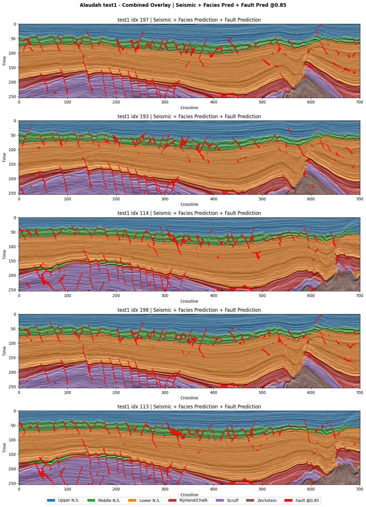

# Deep Learning for Seismic Fault Detection and Facies Classification

How can a seismic interpreter see where geological layers change and where faults cut through them? This team capstone at Istanbul Technical University combines both predictions on the same seismic section. One model detects potential faults, and a second maps six seismic facies classes. An interactive viewer lets interpreters toggle the layers and adjust the fault threshold.

**Best Graduation Design Project Award (2nd Place)**  
YER 2026 — 14th Student Graduation Design Projects Symposium and Exhibition, June 2026.

## Seismic interpretation in action

*Thesis Figure 4.9. Five selected sections from the Alaudah Netherlands F3 test1 split. Colored regions show the predicted facies, and red traces show predicted faults at a probability threshold of 0.85.*

## What we built

- **Fault detection.** A 2D U-Net learned to detect faults from synthetic Wu FaultSeg3D seismic cubes. For the final thesis experiments, we adapted it to real Netherlands F3 data using an existing fault attribute as a teacher signal.
- **Facies classification.** The final thesis model used a U-Net with pyramid pooling and trained on both inline and crossline sections. Class-weighted cross-entropy and Dice loss helped account for the uneven distribution of the six classes.
- **Combined interpretation.** Both models processed the same section independently. Their predictions were overlaid on the seismic image so interpreters could see the stratigraphic units alongside the faults that cut across them.

## Thesis results

Intersection over Union (IoU) measures how much two masks overlap.

### Facies classification on Netherlands F3

The model achieved **0.67 mean IoU across the two test splits**. Lower North Sea reached **0.92 IoU on both splits**, and Upper North Sea reached **0.90 on test2**.

| Metric or facies | Test1 (inline) | Test2 (crossline) |
| --- | ---: | ---: |
| Mean IoU across facies | **0.74** | **0.60** |
| Lower North Sea IoU | 0.92 | 0.92 |
| Upper North Sea IoU | 0.84 | 0.90 |
| Boundary F1 | 0.57 | 0.49 |

Middle North Sea scored approximately 0.75–0.78 IoU across the two splits. On test1, chalk reached 0.72, Scruff 0.66, and Zechstein 0.57. The thesis reports that confusion among the less common deep units accounts for much of the gap between the splits.

### Fault detection

| Evaluation | Reported result |
| --- | --- |
| Synthetic validation at a 0.60 probability threshold | 0.62 IoU |
| Agreement with the real F3 teacher attribute before and after adaptation | 0.06 to 0.43 IoU |

Ground-truth fault labels were unavailable for the real F3 survey.

## Team and contribution

**Thesis title:** *Machine Learning Approaches to Seismic Interpretation: An Integrated Workflow for Fault Detection and Facies Analysis*

**Team:** Oğuz Kaan Ataç, Berkan Güçlü, and Kadir Efe Sancar.

Berkan Güçlü worked alongside his teammates throughout the project, from initial planning through final evaluation and delivery.

## Explore the code

The [prototype notebook](notebooks/seismic_interpretation_prototype.ipynb) shows how the two prediction branches feed the shared viewer. Its facies branch uses an earlier DeconvNet implementation. The figure and results above come from the final thesis experiments, which used the pyramid-pooling facies model and the adapted fault model.

`assets/` contains the thesis figure, `notebooks/` contains the code sample, and `requirements.txt` lists the notebook dependencies. The source seismic volumes and model weights are external to this portfolio. The README and figure can be viewed directly on GitHub.

